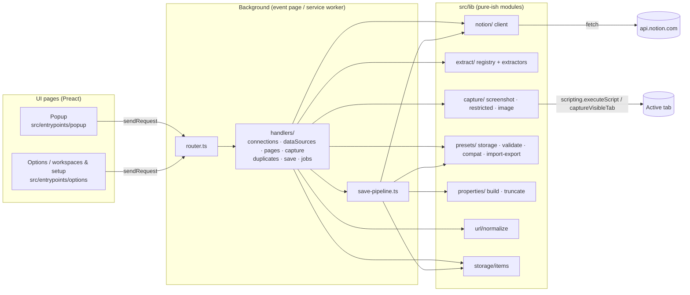
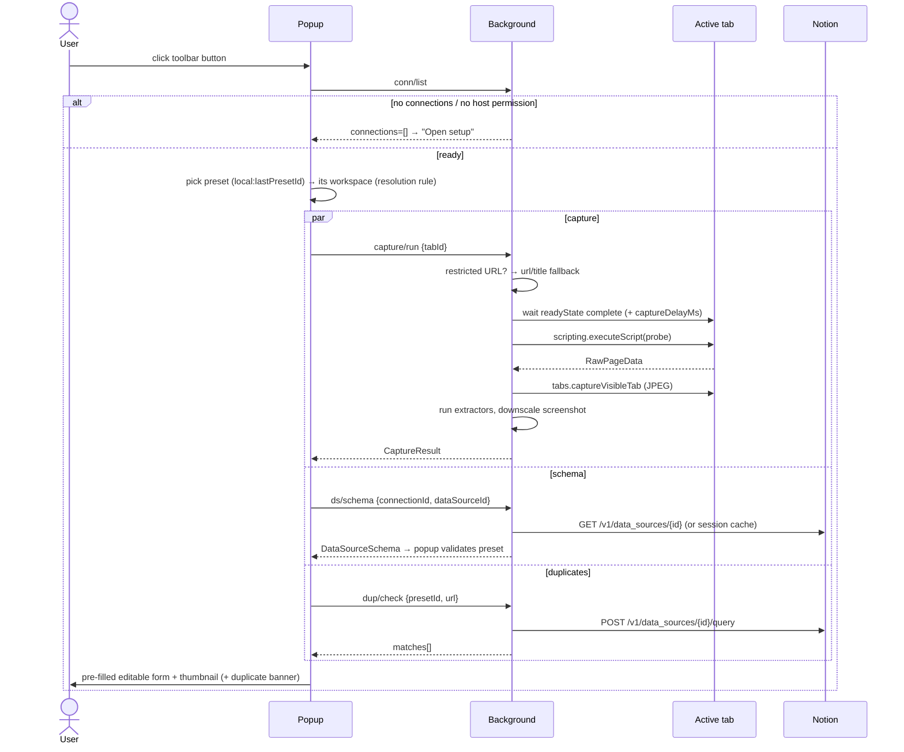
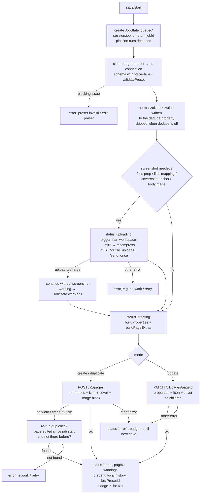
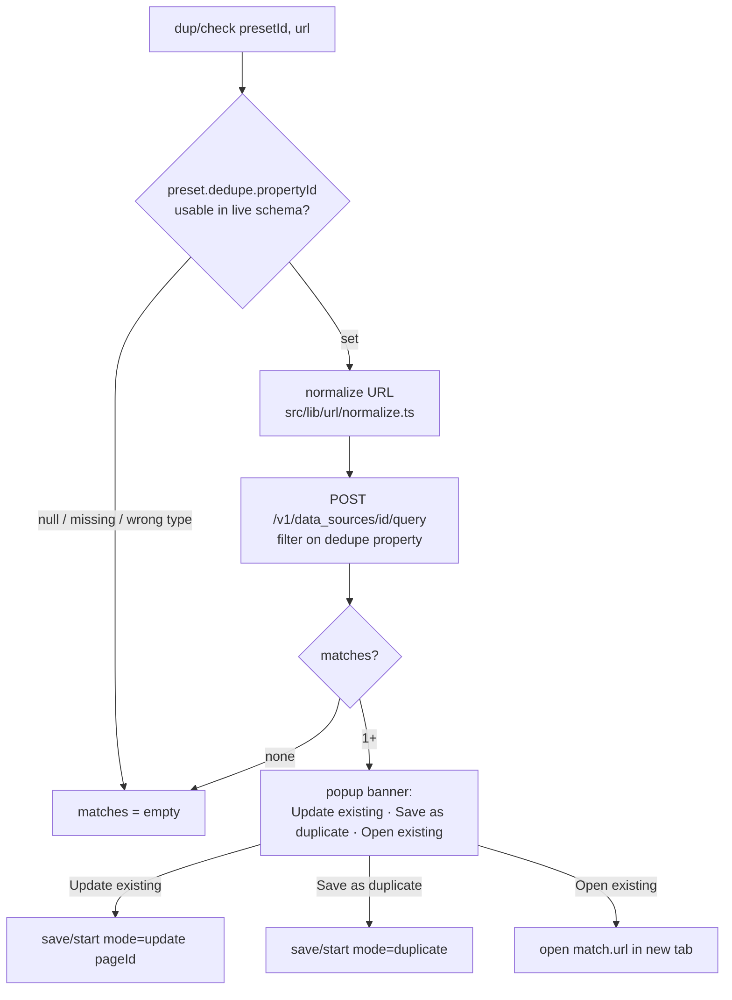

# Architecture

Sitecatch is a Manifest V3 browser extension built with [WXT](https://wxt.dev), TypeScript and Preact. There is no backend: the extension talks only to `https://api.notion.com`.

## Components

| Component | Location | Responsibility |
| --- | --- | --- |
| Popup | `src/entrypoints/popup/` | Preset picker, capture form, duplicate banner, save status. Short-lived: closes whenever the user clicks away. |
| Options page | `src/entrypoints/options/` | Workspaces (setup wizard on first run, opens on install; then the connected workspaces with Add workspace / Replace token / Remove), presets list/editor, settings, import/export, help. |
| Background | `src/entrypoints/background.ts`, `src/background/` | Message `router.ts` dispatches to one handler per request type (`handlers/`). `save-pipeline.ts` runs saves. It owns the tokens (one per connected workspace), all Notion calls, capture and storage writes for jobs. |
| In-page probe | `src/lib/extract/probe.ts` | A self-contained function injected with `scripting.executeScript` into the active tab. It returns `RawPageData` (serializable, no DOM nodes). Sitecatch declares no content scripts. |
| Notion client | `src/lib/notion/` | Plain `fetch`, `Notion-Version: 2026-03-11`, rate-limit queue, retries, multipart upload, error mapping. See [notion-api.md](./notion-api.md). |
| Extractors | `src/lib/extract/` | Registry of pure `ExtractorDef.extract(raw, ctx)` functions (`needsPage: false` ones run even when the page can't be probed). `compat-table.ts` holds the single extractor-output → property-type table. See [extractors.md](./extractors.md). |
| Capture | `src/lib/capture/` | Restricted-URL detection, screenshot (`tabs.captureVisibleTab`, JPEG, downscale). |
| Presets | `src/lib/presets/` | Storage, validation against schema (`PresetIssue.blocking`), compat helpers over `compat-table.ts`, import/export. See [preset-model.md](./preset-model.md). |
| Properties | `src/lib/properties/` | `FormValues` → Notion property JSON, 2000-char chunking, select sanitizing, local UTC offset for date-times, warnings for shortened/skipped values. |
| URL | `src/lib/url/normalize.ts` | URL normalization for duplicate detection. |
| Storage | `src/lib/storage/items.ts` | Every persisted item, typed (WXT storage). |
| UI kit | `src/ui/` | `theme.css` tokens (light/dark), shared components (`Button`, `SegmentedControl`, `Tabs`, `Stepper`, `ErrorBanner`, `Icon`…), property inputs. |

Rules (from [AGENTS.md](../AGENTS.md)):

- **All Notion API calls happen in the background.** UI pages and the probe never see a token.
- Every message response is a `Result<T>` (`src/lib/errors.ts`). Handlers never throw.
- Contract files (`errors.ts`, `notion/types.ts`, `extract/types.ts`, `extract/compat-table.ts`, `presets/types.ts`, `messaging/*`, `storage/items.ts`, `ui/theme.css`) change only through the orchestrator.

## Message protocol

UI pages call `sendRequest({ type, ...params })` (`src/lib/messaging/client.ts`). The background router checks messages with `isRequest()` and ignores anything else, and only answers our own extension pages (see [router sender rules](#cross-browser-notes)). Source of truth: `src/lib/messaging/protocol.ts`.

| Type | Params | Response data | Notes |
| --- | --- | --- | --- |
| `conn/add` | `{ token, tokenKind }` | `ConnectionSummary` | Trims the token, checks the api.notion.com host permission first (`no-host-permission` / `grant-permission`; the UI must call `permissions.request` in its click handler), then `GET /v1/users/me`. On success stores a `Connection` in `local:connections`: a token for a workspace that is already connected **replaces that connection's token in place** (same id and order), otherwise a new connection is appended. Adding a second workspace first pins presets without a workspace to the existing one. A changed token clears the schema cache. |
| `conn/list` | — | `{ hostPermission, connections: ConnectionSummary[] }` | Cheap check on popup/options open. Runs the one-time `local:auth` migration first. **Never returns tokens.** |
| `conn/remove` | `{ connectionId }` | `null` | Forgets one connection's token and clears the session schema cache. Presets bound to it stay (they show as needing a workspace). Also clears the legacy `local:auth` copy when it held that token (or when no connections remain). |
| `ds/list` | `{ connectionId, query? }` | `DataSourceSummary[]` | `POST /v1/search` filtered to data sources, with that connection's token. |
| `ds/schema` | `{ connectionId, dataSourceId, force? }` | `DataSourceSchema` | Read with that connection's token. Cached in `session:schema:<id>` for 5 minutes unless `force` (data source ids are globally unique, so the key has no connection). |
| `pages/search` | `{ connectionId, dataSourceId, query? }` | `PageOption[]` | Relation picker, with that connection's token. Reads the target's (cached) schema for its title property, then `POST /v1/data_sources/{id}/query` (title `contains`, newest edit first), at most `PAGE_OPTIONS_LIMIT` (25). |
| `capture/run` | `{ tabId }` | `CaptureResult` | Probe + screenshot of the tab. Restricted pages return `restricted: true`. |
| `dup/check` | `{ presetId, url }` | `{ matches: DuplicateMatch[] }` | Uses the preset's connection ([workspaces](#workspaces-connections)); unresolved → `no-token` / `edit-preset`. No dedupe property, or one that the live schema no longer has as `url` / `rich_text` / `title` ("Duplicate check is off") → `{ matches: [] }` without a query. Otherwise queries the dedupe property (by its live type) for `urlVariants(url)` — the normalized URL **or** the raw one. |
| `save/start` | `{ presetId, values, capture, mode }` | `{ jobId }` | The connection comes from the preset. Returns right away. The save keeps running in the background. `mode`: `create` / `update {pageId}` / `duplicate`. |
| `job/get` | `{ jobId }` | `JobState` | Polled by the popup. `status`: `queued → uploading → creating → done \| error`. `done` carries `pageUrl` and optional `warnings`. |

## Workspaces (connections)

Sitecatch can be connected to several Notion workspaces at once, one token each ([ADR 0010](./decisions/0010-multiple-workspace-connections.md)). They live in `local:connections` (`Connection[]`, device-only). **Each preset owns its workspace** (`Preset.connectionId`); there is no global "active workspace".

- **Connection id.** The Notion workspace id (`bot.workspace_id` from `GET /v1/users/me`, reported for internal connections and personal access tokens alike) when Notion reports one, so a preset synced to another device resolves there once that device connects the same workspace. Otherwise a random UUID. At most one connection per workspace: `conn/add` matches an existing one by workspace id, by identical token, or (for connections migrated from v0.1, whose id is `legacy-<uuid>`) by asking Notion which workspace the legacy token belongs to.
- **Resolution** (one rule, `src/lib/presets/connection.ts`, used by `dup/check`, the save pipeline, the popup and the editor): `connectionId` connected here → that connection; `connectionId: null` and exactly one connection → the only one; otherwise unresolved → `no-token` with an actionable message ("Connect the “<workspace>” workspace in Sitecatch settings, or pick a workspace for this preset.") and the `edit-preset` action. No connections at all → `no-token` / `open-setup`.
- **Clients.** `createClientProvider` (`src/background/context.ts`) memoizes one `NotionClient` per connection id + token (each keeps its own rate-limit queue). `requireClient(connectionId)` serves `ds/*` and `pages/search`; `requirePresetClient(preset)` serves `dup/check` and the save pipeline. The upload limit comes from the resolved connection's `maxFileUploadBytes`.
- **Migration from v0.1.** `local:auth` (one token) is copied into `local:connections` the first time connections are read while none exist (also kicked off when the background starts). It is idempotent and does **not** delete `local:auth`, so a downgrade keeps working. Replacing the migrated connection's token keeps `local:auth` in step; removing it clears `local:auth`, so "Remove" really forgets the token.

## Data flow

### Capture flow (popup open)

### Save pipeline (background, survives popup close)

Implemented in `src/background/save-pipeline.ts` (all side effects injected, see its tests).

- The upload happens **once**. Its `file_upload` id is reused for the `files` property (`preset.screenshot.filesPropertyId`, the only screenshot → files path the editor offers; a legacy `files` mapping with the `screenshot` extractor still resolves to the same upload), the cover and the image block.
- The screenshot size limit is the preset's connection's `maxFileUploadBytes` (from `bot.workspace_limits`), defaulting to 5 MiB. A larger screenshot is recompressed to fit; if it still doesn't fit (or Notion answers `upload-too-large`) the page is saved **without** it and a warning ("Saved without screenshot: …") is recorded. All save warnings (screenshot plus dropped/shortened-property warnings from `buildProperties`) are stored in `JobState.warnings` on the `done` job, and the popup's success view shows them as small notes.
- **Update** replaces the mapped properties and the cover (and icon). It does **not** append another body image.
- Only the dedupe property's URL is normalized (`normalizeUrl`) — the **normalized URL is what gets written** to it — so a re-save of the same page with `?utm_…` or `#fragment` is detected. Other URL properties keep the captured value. If the dedupe property is missing or no longer `url` / `rich_text` / `title`, validation reports a non-blocking "Duplicate check is off" issue and the pipeline skips normalization and recovery queries.
- Date-times without a UTC offset (popup date-time inputs) get the local offset appended before sending (`withUtcOffset`), since Notion reads offset-less date-times as UTC.
- Errors become `AppError`s ([notion-api.md](./notion-api.md#error--user-message)). A create that failed with a network error, timeout or 5xx is **not** retried. If Notion's error carries `additional_data.committed_resource_id`, the client reports success with that page. Otherwise the pipeline waits briefly and re-runs the duplicate query: a match whose `last_edited_time` is at or after the job start (minus 2 minutes, since Notion rounds to the minute) and that wasn't already there before a `duplicate`-mode create counts as saved. If none is found, the job ends with `network` / `retry`.
- The popup polls `job/get`. If the popup closes, the job still finishes and the toolbar badge shows ✓ (green, cleared after 4 s) or ! (red, cleared when the next save starts). History and `lastPresetId` are written best-effort after the job is marked `done`.

### Duplicate check

Normalization removes noise that doesn't change the page, such as `utm_*` tracking parameters and the `#fragment`. The URL saved into the dedupe property and the URL Sitecatch searches with must go through the **same** normalization, otherwise re-saves won't match. The exact rules live in `src/lib/url/normalize.ts` and its tests.

## Storage layout

All items are defined in `src/lib/storage/items.ts` (WXT typed storage).

| Area | Key | Type | Contents |
| --- | --- | --- | --- |
| `local` | `local:connections` | `Connection[]` | One per connected workspace: `id` (workspace id or UUID), token, `tokenKind` (`personal` / `connection`), bot name, workspace name, `maxFileUploadBytes?`, `validatedAt`. In display order. **Never synced.** |
| `local` | `local:auth` | `AuthState \| null` | **Deprecated** v0.1 single token. Read only by the one-time migration into `local:connections`; cleared when that connection is removed. **Never synced.** |
| `local` | `local:settings` | `Settings` | `captureDelayMs` (default 0), `jpegQuality` (default 0.85). |
| `local` | `local:lastPresetId` | `string \| null` | Preset preselected in the popup. |
| `local` | `local:history` | `HistoryEntry[]` | Last 20 saves (`HISTORY_LIMIT`), newest first. |
| `sync` | `sync:presetIndex` | `string[]` | Preset ids in display order. |
| `sync` | `sync:preset:<id>` | `Preset \| null` | One item per preset (8 KB per-item quota, see [ADR 0005](./decisions/0005-presets-in-storage-sync.md)). |
| `session` | `session:job:<id>` | `JobState \| null` | Save job status, so it survives popup close and background restarts within the browser session. |
| `session` | `session:schema:<dataSourceId>` | `CachedSchema \| null` | Schema cache with `fetchedAt`. Pass `force` to refresh. |
| `session` | `session:popup:lastJob` | `LastJobRecord \| null` | The popup's most recent save (`{ jobId, presetId, url, mode }`), so a reopened popup can resume showing it. |

`storage.session` is in-memory and cleared when the browser closes. Screenshots are never written to storage. They travel inside `CaptureResult` in the `save/start` message.

## Cross-browser notes

- **Background context.** WXT builds MV3 for both browsers. Firefox runs the background as a non-persistent **event page** (`background.scripts`). Chrome runs it as a **service worker**. Either can be stopped when idle and restarted on the next event.
- **No background globals for state.** Anything that has to outlive one event (jobs, schema cache, connections) lives in `storage`. An in-memory value, such as the request queue, may only be something that can be lost safely.
- Register listeners synchronously at the top level of `defineBackground` (router, `onInstalled`) so they exist when the browser wakes the background up for an event.
- **Router sender rules** (`src/background/router.ts`, `isTrustedSender`): one `runtime.onMessage` listener that replies with `sendResponse` + `return true` (WXT's fakeBrowser only delivers replies that way). It ignores anything that isn't `isRequest()`, and anything not sent by our own extension pages: `sender.id` must equal `runtime.id`, and `sender.url` (when present) must be inside the extension origin; a sender with a `tab` but no extension URL (a content script) is ignored. Handler throws become `err(toAppError(…))`.
- **Service-worker limits (Chrome).** No DOM is available. Screenshot downscaling must use `OffscreenCanvas` / `createImageBitmap`, which work in both browsers' backgrounds.
- `tabs.captureVisibleTab` relies on the `activeTab` grant that a toolbar click gives. Verified in the Firefox MV3 popup (manual E2E, 2026-10-18), so no broader host permission is needed. Chrome is not yet smoke-tested ([testing.md](./testing.md#manual-e2e-checklist)).
- `browser.permissions.request` must be called directly from a user click handler (the "Grant access" button).
- On install, `runtime.onInstalled` with `reason === 'install'` opens the options page (setup wizard).
- Firefox needs ≥ 140 (desktop) and ≥ 142 (Android) for `data_collection_permissions`. See [permissions-privacy.md](./permissions-privacy.md).
