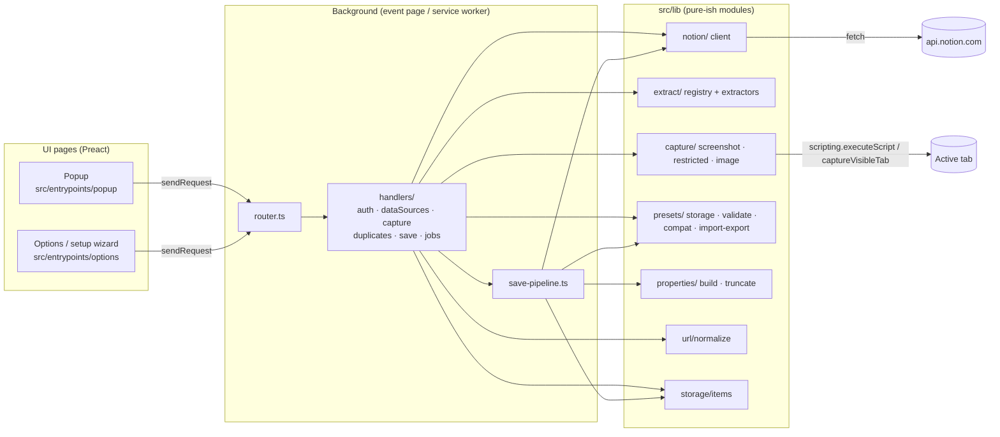
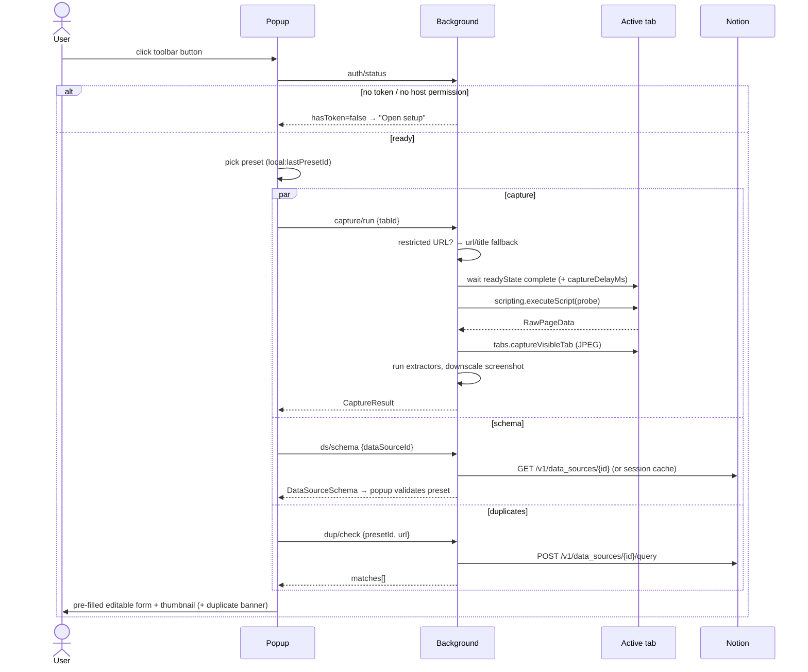
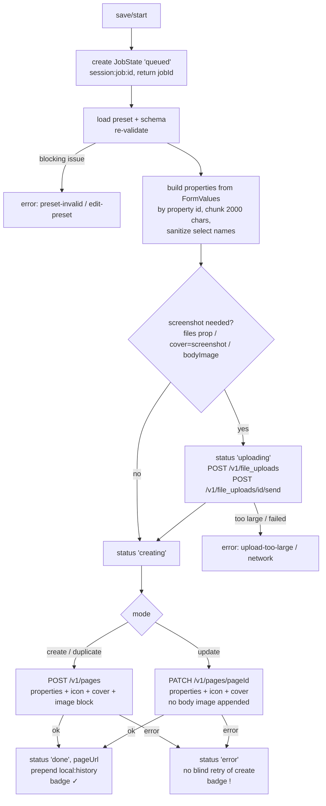
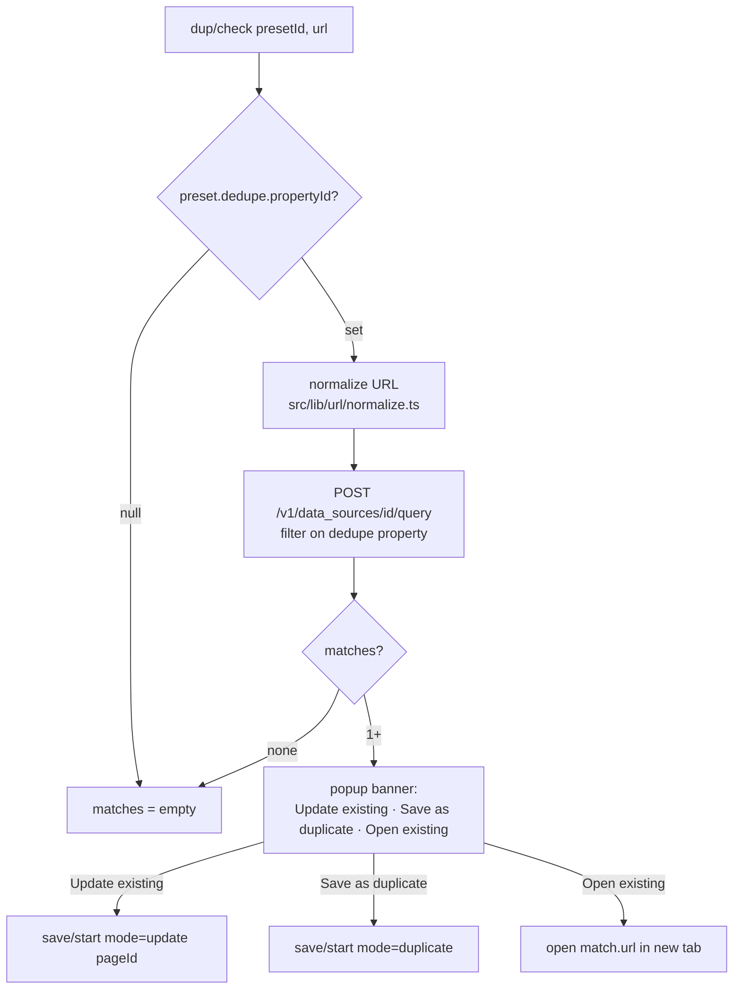

# Architecture

Sitecatch is a Manifest V3 browser extension built with [WXT](https://wxt.dev), TypeScript and Preact. There is no backend: the extension talks only to `https://api.notion.com`.

## Components

| Component | Location | Responsibility |
| --- | --- | --- |
| Popup | `src/entrypoints/popup/` | Preset picker, capture form, duplicate banner, save status. Short-lived: closes whenever the user clicks away. |
| Options page | `src/entrypoints/options/` | Setup wizard (opens on install), presets list/editor, settings, import/export, help. |
| Background | `src/entrypoints/background.ts`, `src/background/` | Message `router.ts` dispatches to one handler per request type (`handlers/`). `save-pipeline.ts` runs saves. It owns the token, all Notion calls, capture and storage writes for jobs. |
| In-page probe | `src/lib/capture/` | A function injected with `scripting.executeScript` into the active tab. It returns `RawPageData` (serializable, no DOM nodes). Sitecatch declares no content scripts. |
| Notion client | `src/lib/notion/` | Plain `fetch`, `Notion-Version: 2026-03-11`, rate-limit queue, retries, multipart upload, error mapping. See [notion-api.md](./notion-api.md). |
| Extractors | `src/lib/extract/` | Registry of pure `ExtractorDef.extract(raw, ctx)` functions. See [extractors.md](./extractors.md). |
| Capture | `src/lib/capture/` | Restricted-URL detection, screenshot (`tabs.captureVisibleTab`, JPEG, downscale). |
| Presets | `src/lib/presets/` | Storage, validation against schema, compat matrix, import/export. See [preset-model.md](./preset-model.md). |
| Properties | `src/lib/properties/` | `FormValues` → Notion property JSON, 2000-char chunking, select sanitizing. |
| URL | `src/lib/url/normalize.ts` | URL normalization for duplicate detection. |
| Storage | `src/lib/storage/items.ts` | Every persisted item, typed (WXT storage). |
| UI kit | `src/ui/` | `theme.css` tokens (light/dark), shared components, property inputs. |

Rules (from [AGENTS.md](../AGENTS.md)):

- **All Notion API calls happen in the background.** UI pages and the probe never see the token.
- Every message response is a `Result<T>` (`src/lib/errors.ts`). Handlers never throw.
- Contract files (`errors.ts`, `notion/types.ts`, `extract/types.ts`, `presets/types.ts`, `messaging/*`, `storage/items.ts`, `ui/theme.css`) change only through the orchestrator.

## Message protocol

UI pages call `sendRequest({ type, ...params })` (`src/lib/messaging/client.ts`). The background router checks messages with `isRequest()` and ignores anything else. Source of truth: `src/lib/messaging/protocol.ts`.

| Type | Params | Response data | Notes |
| --- | --- | --- | --- |
| `auth/validate` | `{ token }` | `{ botName, workspaceName \| null }` | `GET /v1/users/me`. Stores the token in `local:auth` only on success. |
| `auth/status` | — | `{ hasToken, hostPermission, workspaceName? }` | Cheap check on popup/options open. **Never returns the token.** |
| `auth/clear` | — | `null` | Forgets the token. |
| `ds/list` | `{ query? }` | `DataSourceSummary[]` | `POST /v1/search` filtered to data sources. |
| `ds/schema` | `{ dataSourceId, force? }` | `DataSourceSchema` | Cached in `session:schema:<id>` unless `force`. |
| `capture/run` | `{ tabId }` | `CaptureResult` | Probe + screenshot of the tab. Restricted pages return `restricted: true`. |
| `dup/check` | `{ presetId, url }` | `{ matches: DuplicateMatch[] }` | Queries the preset's data source on its dedupe property with the normalized URL. |
| `save/start` | `{ presetId, values, capture, mode }` | `{ jobId }` | Returns right away. The save keeps running in the background. `mode`: `create` / `update {pageId}` / `duplicate`. |
| `job/get` | `{ jobId }` | `JobState` | Polled by the popup. `status`: `queued → uploading → creating → done \| error`. |

## Data flow

### Capture flow (popup open)

### Save pipeline (background, survives popup close)

- The upload happens **once**. Its `file_upload` id is reused for the `files` property, the cover and the image block.
- **Update** replaces the mapped properties and the cover (and icon). It does **not** append another body image.
- Errors become `AppError`s ([notion-api.md](./notion-api.md#error--user-message)). A create that failed with 5xx or a timeout is **not** retried automatically. Re-running the duplicate check is how Sitecatch finds out whether the page actually got saved.
- The popup polls `job/get`. If the popup closes, the job still finishes and the toolbar badge shows ✓ or !. The next time the popup opens it can show the latest job.

### Duplicate check

Normalization removes noise that doesn't change the page, such as `utm_*` tracking parameters and the `#fragment`. The URL saved into the dedupe property and the URL Sitecatch searches with must go through the **same** normalization, otherwise re-saves won't match. The exact rules live in `src/lib/url/normalize.ts` and its tests.

## Storage layout

All items are defined in `src/lib/storage/items.ts` (WXT typed storage).

| Area | Key | Type | Contents |
| --- | --- | --- | --- |
| `local` | `local:auth` | `AuthState \| null` | Token, bot name, workspace name, `validatedAt`. **Never synced.** |
| `local` | `local:settings` | `Settings` | `captureDelayMs` (default 0), `jpegQuality` (default 0.85). |
| `local` | `local:lastPresetId` | `string \| null` | Preset preselected in the popup. |
| `local` | `local:history` | `HistoryEntry[]` | Last 20 saves (`HISTORY_LIMIT`), newest first. |
| `sync` | `sync:presetIndex` | `string[]` | Preset ids in display order. |
| `sync` | `sync:preset:<id>` | `Preset \| null` | One item per preset (8 KB per-item quota, see [ADR 0005](./decisions/0005-presets-in-storage-sync.md)). |
| `session` | `session:job:<id>` | `JobState \| null` | Save job status, so it survives popup close and background restarts within the browser session. |
| `session` | `session:schema:<dataSourceId>` | `CachedSchema \| null` | Schema cache with `fetchedAt`. Pass `force` to refresh. |

`storage.session` is in-memory and cleared when the browser closes. Screenshots are never written to storage. They travel inside `CaptureResult` in the `save/start` message.

## Cross-browser notes

- **Background context.** WXT builds MV3 for both browsers. Firefox runs the background as a non-persistent **event page** (`background.scripts`). Chrome runs it as a **service worker**. Either can be stopped when idle and restarted on the next event.
- **No background globals for state.** Anything that has to outlive one event (jobs, schema cache, auth) lives in `storage`. An in-memory value, such as the request queue, may only be something that can be lost safely.
- Register listeners synchronously at the top level of `defineBackground` (router, `onInstalled`) so they exist when the browser wakes the background up for an event.
- **Service-worker limits (Chrome).** No DOM is available. Screenshot downscaling must use `OffscreenCanvas` / `createImageBitmap`, which work in both browsers' backgrounds.
- `tabs.captureVisibleTab` relies on the `activeTab` grant that a toolbar click gives. Behavior in the Firefox MV3 popup is still an open item to verify. The fallback is to request `<all_urls>` as an optional permission at capture time ([roadmap.md](./roadmap.md)).
- `browser.permissions.request` must be called directly from a user click handler (the "Grant access" button).
- On install, `runtime.onInstalled` with `reason === 'install'` opens the options page (setup wizard).
- Firefox needs ≥ 140 (desktop) and ≥ 142 (Android) for `data_collection_permissions`. See [permissions-privacy.md](./permissions-privacy.md).
