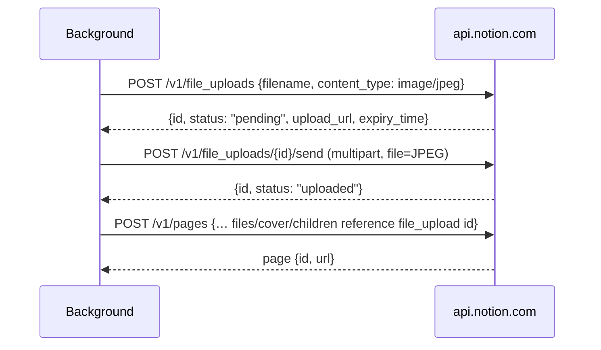

# Notion API

How Sitecatch talks to Notion. The plain-`fetch` client in `src/lib/notion/` makes every call from the **background** context ([ADR 0004](./decisions/0004-plain-fetch-client.md)). The popup and options pages never see the token and never call Notion directly.

The facts on this page were checked against developers.notion.com in October 2026, with links in each section. Notion's docs and UI now say **connection** where they used to say integration ("internal connection", "API token"). Older material says "integration" and "Internal Integration Secret". These are the same thing.

## Version and authentication

Every request sends:

```http
Authorization: Bearer <token>
Notion-Version: 2026-03-11
Content-Type: application/json        (except the multipart file send)
```

- `2026-03-11` is the latest API version. Compared with `2025-09-03`, it makes three changes. Append block children takes a `position` object instead of the `after` parameter. `in_trash` replaces `archived`. The `transcription` block is now called `meeting_notes`. None of these affect Sitecatch's v0 calls, but code must read `in_trash` and never `archived`. ([Upgrade guide](https://developers.notion.com/guides/get-started/upgrade-guide-2026-03-11), [Changes by version](https://developers.notion.com/reference/changes-by-version))
- The token is an **internal connection API token**, starting with `ntn_`. It acts as a bot user. That bot sees only the pages and databases explicitly shared with it, plus their children. ([Internal connections](https://developers.notion.com/guides/get-started/internal-connections))
- Only a **Workspace Owner** can create an internal connection. See [setup-guide.md](./setup-guide.md).

## Data sources model

Since `2025-09-03`, a Notion **database** is a container for one or more **data sources**. Each data source has its own schema (properties) and its own rows (pages). Database ids did not change. Data source ids are new, and you need one to read a schema or create rows. ([Changes by version](https://developers.notion.com/reference/changes-by-version), [Working with databases](https://developers.notion.com/guides/data-apis/working-with-databases))

So Sitecatch works with **data sources** everywhere:

- The "pick a database" list is a list of data sources (`DataSourceSummary`, with the parent `databaseId` when known).
- A preset stores a `dataSourceId` ([preset-model.md](./preset-model.md)).
- Pages are created with `parent: { "type": "data_source_id", "data_source_id": "…" }`.

A database with one data source shows up as one entry in the list. A database with several sources shows one entry per source.

## Endpoints used

| Purpose | Request | Message type |
| --- | --- | --- |
| Validate token, get bot/workspace name | `GET /v1/users/me` | `auth/validate` |
| List data sources shared with the connection | `POST /v1/search` with `{"filter": {"property": "object", "value": "data_source"}, "query"?: "…"}` (paginated) | `ds/list` |
| Read a data source schema | `GET /v1/data_sources/{id}` | `ds/schema` |
| Find duplicates by URL | `POST /v1/data_sources/{id}/query` with a filter on the dedupe property | `dup/check` |
| Create a file upload | `POST /v1/file_uploads` with `{"filename": "…jpg", "content_type": "image/jpeg"}` | `save/start` |
| Send the file bytes | `POST /v1/file_uploads/{id}/send` (`multipart/form-data`, field `file`) | `save/start` |
| Create the page | `POST /v1/pages` | `save/start` (mode `create` / `duplicate`) |
| Update an existing page | `PATCH /v1/pages/{id}` | `save/start` (mode `update`) |

References: [Retrieve your token's bot user](https://developers.notion.com/reference/get-self), [Search by title](https://developers.notion.com/reference/post-search), [Retrieve a data source](https://developers.notion.com/reference/retrieve-a-data-source), [Query a data source](https://developers.notion.com/reference/query-a-data-source), [Create a file upload](https://developers.notion.com/reference/create-file), [Send a file upload](https://developers.notion.com/reference/upload-file), [Create a page](https://developers.notion.com/reference/post-page), [Update page](https://developers.notion.com/reference/patch-page).

Notes:

- `GET /v1/users/me` works whatever the connection's user-information capability is, so "No user information" is enough. The response includes `bot.workspace_name` and `bot.workspace_limits.max_file_upload_size_in_bytes`. The client can read the upload limit from there instead of hard-coding it.
- Page `properties` can be keyed by property **name or id**. Sitecatch always keys by **id**, so renaming a property doesn't break a preset ([ADR 0006](./decisions/0006-map-properties-by-id.md)).
- Search returns only objects shared with the connection. An empty result almost always means nothing has been shared yet (see [setup-guide.md](./setup-guide.md#cant-see-your-database)).

## File upload flow (screenshots)

Screenshots go up through Notion's **Direct Upload** (single-part) API and are attached by id ([ADR 0007](./decisions/0007-screenshot-jpeg-file-upload.md)). ([Uploading small files](https://developers.notion.com/guides/data-apis/uploading-small-files), [File Upload object](https://developers.notion.com/reference/file-upload), [Working with files and media](https://developers.notion.com/guides/data-apis/working-with-files-and-media))



These facts shape the design:

- **Upload once, attach many times.** One page create can use the same `file_upload` id for a `files` property, the page `cover` and an `image` block. Sitecatch uploads the screenshot at most once per save.
- **Size limits.** A single-part send accepts up to 20 MB. In **Free** workspaces each file is limited to **5 MiB** (paid plans: 5 GiB). Sitecatch downscales and re-encodes the JPEG to stay under about 4.5 MiB, so it works on every plan. The save pipeline recompresses to the workspace's own limit (`maxFileUploadBytes` from `GET /v1/users/me`, default 5 MiB). If the file still doesn't fit, the page is saved without the screenshot.
- **1-hour expiry.** An upload that isn't attached within **1 hour** expires: `expiry_time` passes and the status becomes `expired`. Sitecatch uploads right before it creates the page, so this matters only if a save stalls. Once the file is attached, `expiry_time` is cleared and the file is permanent. The API offers no way to delete an upload.
- The send endpoint expects `multipart/form-data`. With `fetch` + `FormData`, **don't set `Content-Type` yourself**, so the browser adds the boundary.
- Filenames (with extension) are limited to 900 bytes.

## Property value JSON shapes

These are the shapes the property builders (`src/lib/properties/`) send, keyed by property id. ([Page property values](https://developers.notion.com/reference/page-property-values))

| Type | Write shape |
| --- | --- |
| `title` | `{"title": [{"type": "text", "text": {"content": "…"}}]}` |
| `rich_text` | `{"rich_text": [{"type": "text", "text": {"content": "…"}}, …]}` |
| `url` | `{"url": "https://…"}` (or `null`) |
| `email` | `{"email": "a@b.c"}` |
| `phone_number` | `{"phone_number": "+1 …"}` |
| `number` | `{"number": 42}` |
| `checkbox` | `{"checkbox": true}` |
| `select` | `{"select": {"name": "Article"}}` (or `null`) |
| `multi_select` | `{"multi_select": [{"name": "Design"}, {"name": "Tools"}]}` |
| `status` | `{"status": {"name": "To read"}}` |
| `date` | `{"date": {"start": "2026-10-18"}}`, optionally with `"end"` |
| `files` (uploaded) | `{"files": [{"name": "screenshot.jpg", "type": "file_upload", "file_upload": {"id": "…"}}]}` |
| `files` (external) | `{"files": [{"name": "favicon.png", "type": "external", "external": {"url": "https://…"}}]}` |

Page-level fields:

```json
{
  "parent": { "type": "data_source_id", "data_source_id": "…" },
  "properties": { "title": { "title": [ … ] }, "%3AbQx": { "url": "…" } },
  "icon":  { "type": "external", "external": { "url": "https://example.com/favicon.ico" } },
  "cover": { "type": "file_upload", "file_upload": { "id": "…" } },
  "children": [
    { "type": "image", "image": { "type": "file_upload", "file_upload": { "id": "…" } } }
  ]
}
```

When the preset uses `cover: "ogImage"`, `cover` is `{"type": "external", "external": {"url": "<og:image>"}}` instead.

Rules the builders must follow:

- **Text length.** A rich-text `text.content` holds at most **2000 characters**, and a rich-text array holds at most **100 elements**. Long text is split into 2000-character chunks, and anything past 100 chunks is cut off. URLs are limited to 2000 characters. ([Request limits](https://developers.notion.com/reference/request-limits))
- **Select / multi-select.** Writing an option **name** that doesn't exist creates the option, as long as the connection can write to the data source. Option names **cannot contain commas**, so the builder replaces them. A multi-select value holds at most 100 options.
- **Status.** A page write **cannot** create a status option. Only existing option names or ids are accepted. This is why `option-missing` blocks saving for status properties (see [preset-model.md](./preset-model.md#validation)).
- **Files.** Each file object needs a `name`. Writing a `files` property replaces its whole list.
- **Request size.** A whole request is limited to 500 KB and 1000 block elements.

## Rate limits and retry policy

([Request limits](https://developers.notion.com/reference/request-limits), [Status codes](https://developers.notion.com/reference/status-codes))

Notion has three kinds of limit: a per-connection budget, a per-workspace budget shared by all connections, and limits on some endpoints. The per-connection budget is 600 requests/minute on Business and Enterprise plans and 180/minute (about 3 per second) on all other plans. Going over any limit returns **HTTP 429** `rate_limited` with a `Retry-After` header (whole seconds). Sitecatch handles **529** `service_overload` the same way.

Sitecatch's client:

1. **Queues** all requests and spaces them about **3 requests/second** apart, which is safe on every plan. A single save makes 1–5 requests, so the queue rarely has to wait.
2. **429 / 529.** Waits `Retry-After` seconds, then retries the same request a few times at most. If the header is missing, it backs off exponentially with jitter. It doesn't retry a 429 whose `additional_data.rate_limit_reason` is `"public_api_request_blocked"`. When retries run out, the error is `rate-limited`.
3. **500 / 502 / 503 / 504 and network errors.** Retries **only idempotent requests**: `GET`, plus `POST /v1/search` and `POST …/query`, which only read.
4. **Never blindly retries page creation** (`POST /v1/pages`) or any other write. A create that timed out or returned 5xx may have succeeded, and retrying it would make a duplicate page. The job ends with an error instead. The next attempt runs the duplicate check again, so if the page was saved after all, the user sees "Update existing / Save as duplicate / Open existing".
   - An error response to `POST /v1/pages` that includes `additional_data.committed_resource_id` means the write was saved. The client reports success with that id and a URL built from it (`https://www.notion.so/<id without dashes>`).
   - Otherwise the save pipeline re-runs the duplicate query itself before giving up (see [architecture.md](./architecture.md#save-pipeline-background-survives-popup-close)).
5. Doesn't retry any other 4xx; the request has to be fixed instead.

## Error → user message

Notion errors are mapped to `AppError` (`src/lib/errors.ts`). Each message says what happened and what to do next. The raw Notion `code` and `message` go into `detail`. The token never does.

| Notion response | `AppErrorCode` | `action` | User message (guideline) |
| --- | --- | --- | --- |
| No token stored | `no-token` | `open-setup` | "Connect Sitecatch to Notion first." |
| Host permission for api.notion.com missing | `no-host-permission` | `grant-permission` | "Sitecatch needs permission to reach api.notion.com. Click Grant access." |
| 401 `unauthorized` | `invalid-token` | `open-setup` | "Notion rejected your token. It may have been revoked or mistyped. Paste a new token in setup." |
| 404 `object_not_found` | `db-not-shared` | `reshare-db` | "Sitecatch can't see this database. In Notion, open it → ••• → Connections → add Sitecatch." |
| 403 `restricted_resource` (permission) | `db-not-shared` | `reshare-db` | "Sitecatch doesn't have permission here. Check that the connection has Read, Update and Insert content, and that the database is shared." |
| 403 `restricted_resource` (Free workspace block limit) | `validation` | — | Shows Notion's message: the workspace has used all its free blocks, so upgrade or ask the owner. ([Workspace block limits](https://developers.notion.com/reference/workspace-block-limits)) |
| 400 `validation_error` | `validation` | `edit-preset` | "Notion rejected a property value: <Notion message>. Check the preset." |
| 409 `conflict_error` | `network` | `retry` | "Notion couldn't save right now. Try again." |
| 429 / 529 after retries | `rate-limited` | `retry` | "Notion is busy. Wait a minute and try again." |
| 5xx, timeout, offline | `network` | `retry` | "Couldn't reach Notion. Check your connection and try again." After a failed create: "It may have been saved. Reopen Sitecatch to check." |
| Screenshot over the limit after downscaling | `upload-too-large` | — | Not a save failure: the background recompresses to `maxFileUploadBytes`, and if it still doesn't fit, saves the page without the screenshot (warning in `JobState.warnings`, shown in the popup). |
| Schema doesn't match the preset | `preset-invalid` | `edit-preset` | "Your database changed: <issue>. Fix the preset to continue." |
| Anything else | `unknown` | `retry` | "Something went wrong. Try again." |

Both 403 rows have the same status code; the client tells them apart by the message text. See [Open questions](#open-questions).

## Open questions

- `AppErrorCode` has no code of its own for 403 `restricted_resource`. The table above maps it to `db-not-shared` (permission) or `validation` (block limit). A dedicated `forbidden` / `plan-limit` code would make the UI copy clearer. That is a contract change, so it goes through the orchestrator.
