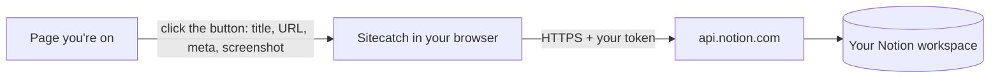

# Permissions & privacy

Sitecatch asks for as little access as it can and sends data to exactly one place: **the Notion API, using your own token**. There is no Sitecatch server, account, analytics or telemetry. This page is also the basis for the store privacy policy.

## Permissions

From `wxt.config.ts`:

| Permission | Why Sitecatch needs it | When it is used |
| --- | --- | --- |
| `activeTab` | Temporary access to **the tab you're on, only after you click the Sitecatch button**. Lets Sitecatch read that page's title/metadata and take a screenshot of it. Sitecatch never gets access to other tabs or to pages you don't click on. | Each time you open the popup. |
| `scripting` | Runs a small read-only function in that tab (via `scripting.executeScript`) to collect title, URL, meta tags, links, selected text and fonts. It changes nothing on the page. | Each capture. |
| `storage` | Saves your token and settings on this device, your presets (synced), and temporary save status. | Always. |
| Host: `https://api.notion.com/*` | Calls the Notion API to list your databases, read their properties, upload the screenshot and create pages. **This is the only host Sitecatch talks to.** | Setup and every save. |

Sitecatch does **not** request `<all_urls>`, `tabs`, `cookies`, `history`, `webRequest`, or access to `notion.so`. It doesn't use your Notion browser session.

`activeTab` is enough for screenshots from the Firefox MV3 popup (verified in the manual E2E, 2026-10-18), so Sitecatch needs no broader site access.

### What you see at install

- **Firefox**: the install prompt asks for access to your data for **api.notion.com** and shows the required data collection (below). `activeTab`, `scripting` and `storage` show no separate warning. In Firefox (MV3) you can revoke the api.notion.com access later in `about:addons` → Sitecatch → Permissions. If you do, the setup wizard and popup show **Grant access** to turn it back on.
- **Chrome**: "Read and change your data on api.notion.com". No other warnings.

### Firefox data collection declaration

Firefox (140+ desktop, 142+ Android) requires add-ons to declare what data they transmit outside the browser ([Extension Workshop](https://extensionworkshop.com/documentation/develop/firefox-builtin-data-consent/)). Sitecatch declares as **required**:

| Category | Firefox definition | What Sitecatch sends (to Notion only) |
| --- | --- | --- |
| `browsingActivity` | Information about the websites you visit, such as URLs and domains. | The URL, canonical URL and domain of the page **you choose to save**. |
| `websiteContent` | Anything visible on a website: text, images, links… | The page title, descriptions, selected text, font names, favicon/og:image URLs and the screenshot **of the page you choose to save**. |

Both are required because saving a website to Notion *is* sending this data. Nothing is sent unless you click Save (the duplicate check also sends the URL of the current page to your Notion database when the popup opens).

## Data flow

**Your browser → api.notion.com. Nothing else.**

| Data | Where it goes | When |
| --- | --- | --- |
| Token | `api.notion.com` (Authorization header) | Every API call |
| Page URL | `api.notion.com` | Duplicate check (popup open) and save |
| Title, descriptions, selection, fonts, favicon/og:image URLs, values you typed | `api.notion.com` → your database | Save |
| Screenshot (JPEG) | `api.notion.com` file upload → your page | Save, if the preset uses a screenshot |
| Favicon / og:image | Referenced by URL from Notion. Notion and your browser load them from the original site. | When you view the page in Notion |

What Notion does with this data is covered by Notion's own terms and privacy policy. Sitecatch is not affiliated with Notion.

## What is stored, and where

| What | Storage | Leaves the device? |
| --- | --- | --- |
| Notion token, token kind, bot/workspace name, upload limit | `storage.local` (`local:auth`) | No (only sent to api.notion.com as a header) |
| Settings (capture delay, JPEG quality) | `storage.local` | No |
| Last 20 saves (title, URLs, preset, time) | `storage.local` (`local:history`) | No |
| Presets | `storage.sync` | Synced by **your browser's** sync service (Mozilla account / Google account), if enabled |
| Save job status, schema cache, the popup's last job | `storage.session` | No. Cleared when the browser closes. |

Screenshots are **not** stored by Sitecatch. They exist in memory until uploaded.

## Token storage

- The token is stored in **`storage.local`**, which lives **unencrypted in your browser profile** on disk (same as other extension data). Anyone with access to your OS account/profile could read it. A **personal access token** can read and edit everything you can in that workspace until it expires or you revoke it; an **internal connection** token reaches only the pages you've shared with the Sitecatch connection. Pick the narrower one if that matters to you.
- It is **never synced** (`storage.sync` is never used for it), **never exported** with presets, **never logged**, never shown back in the UI after validation, and never sent anywhere except `api.notion.com`.
- Remove it: Options → Settings → **Disconnect** (calls `auth/clear`), or uninstall Sitecatch. To fully revoke it, use Notion's Developer portal: revoke the personal access token, or delete the connection / refresh its token ([setup-guide.md](./setup-guide.md)).

## Remote code

None. All code ships in the extension package. No CDN scripts, no `eval`, no remote configuration.
