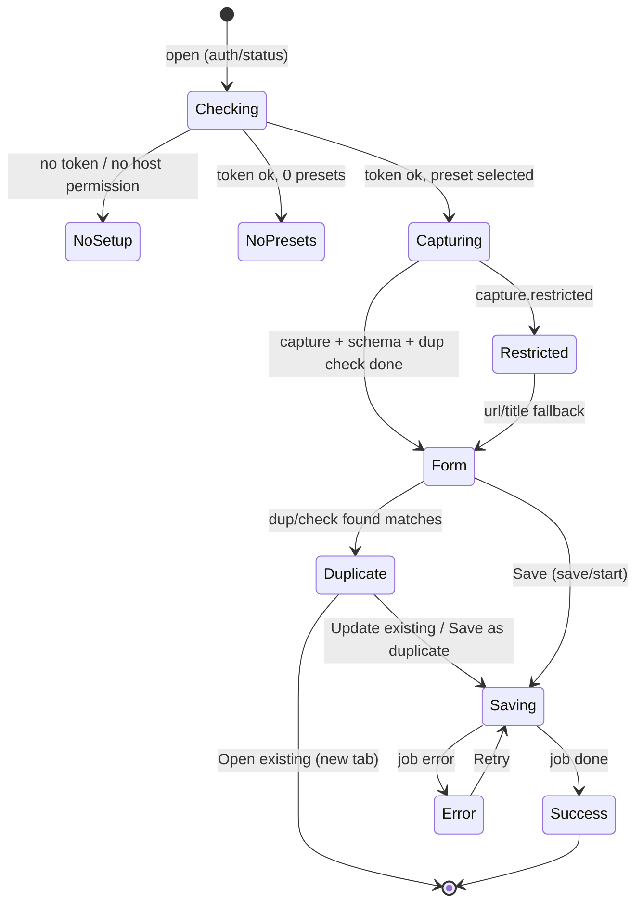

# UI flows

Two UI surfaces: the **popup** (toolbar button) and the **options page** (setup wizard, presets, settings). Both are Preact apps that talk to the background only through `sendRequest()` ([architecture.md](./architecture.md#message-protocol)). Styling uses the tokens in `src/ui/theme.css` (light/dark).

## Popup

### No setup

Shown when `auth/status` reports `hasToken: false` or `hostPermission: false`. Message ("Connect Sitecatch to Notion to start saving") plus an **Open setup** button that opens the options wizard. If only the host permission is missing, a **Grant access** button calls `browser.permissions.request` from the click handler. There are no other controls.

If there are no presets yet: "Create your first preset" → opens Options → Presets.

### Capturing

- **Preset picker** at the top, preselected with `local:lastPresetId` (falls back to the first preset). Changing the preset stores it as the new `lastPresetId`, re-runs schema validation and the duplicate check, and re-resolves the form. The capture is reused, and the user's edits are kept for properties the new preset also shows with the same input kind (e.g. the title).
- Three requests run in parallel: `capture/run`, `ds/schema`, `dup/check` (with the tab URL; the capture URL if the tab URL is unknown; skipped when the preset has no dedupe property). Skeletons are shown for the thumbnail and fields, and a polite live region announces "Capturing page…".
- Capture waits for `readyState === 'complete'` plus the optional delay from Settings.
- If `capture/run` fails, the error is shown with **Retry** and the form falls back to the tab's URL and title (like a restricted page).

### Form

- Thumbnail of the screenshot, if the preset uses one, plus the page title/domain.
- One field per **visible mapping**: every `ask` mapping, plus `extractor`/`static` mappings with `editableInPopup`. The input matches the property type (Text, Url, Number, Checkbox, Date, Select, MultiSelect with "create option", Status).
- Pre-filled from extractors (primary → fallbacks), `ask.default`, or the static value.
- Mappings that aren't shown as fields (non-editable extractor/static) are listed in a compact read-only summary, e.g. "URL → https://example.com/…".
- `required` ask fields block **Save** until filled; the footer says which fields are missing.
- **Save** stays disabled while capturing, loading the schema, or checking for duplicates. Its label is "Save to *Database*" (or "Save as duplicate" when duplicates were found). **Ctrl/⌘ + Enter** saves from anywhere; the first editable field gets focus.
- Capture warnings (e.g. "Screenshot was downscaled") appear as small notes.
- **Preset issues** ([preset-model.md](./preset-model.md#validation)): blocking issues disable Save and show **Edit preset**. Non-blocking ones (renamed, select option will be created, "Duplicate check is off: …" when the dedupe property was deleted or changed type) show as a dismissible notice.

### Duplicate banner

Shown above the form when `dup/check` returns matches: "Already in *Resources*: **<title>** (saved <relative time>)."

| Button | Effect |
| --- | --- |
| **Update existing** | `save/start` with `mode: {kind:'update', pageId}`. Replaces mapped properties, cover and icon. No new body image. |
| **Save as duplicate** | `save/start` with `mode: {kind:'duplicate'}`. Creates a new page. |
| **Open existing** | Opens the existing page's Notion URL in a new tab. Saves nothing. |

With several matches, the banner shows the most recently edited one and adds "and N more page(s) with this URL". The footer **Save** button becomes **Save as duplicate**.

### Saving

`save/start` returns a `jobId`. The popup watches the job in `storage.session` (`watchJob`) and polls `job/get` every second as a fallback, showing the step: *Uploading screenshot…* (`uploading`), then *Saving to Notion…* (`creating`). After 20 s it adds "Still working… it continues in the background — you can close this popup." The user may close the popup at any time; that only stops watching. The save continues in the background and the toolbar badge shows ✓ (done) or ! (error).

The popup remembers its most recent job in `session:popup:lastJob` (`{ jobId, presetId, url, mode }`). Reopened on the same page, it shows that job's progress if it is still running, or its error if it failed.

### Success

"Saved to *Resources*" with an **Open in Notion** button (`JobState.pageUrl`, opens in a new tab), **Save with another preset** (back to the form, duplicate check re-run) and **Close**. Save warnings (`JobState.warnings`, e.g. "Saved without screenshot: …" or a property that was shortened/skipped) appear under the card as small notes. The popup doesn't close by itself. The entry is added to `local:history`. Reopening it on the same page shows the duplicate banner.

### Error

The `AppError.message` in plain language, with a button for `action`:

| `action` | Button |
| --- | --- |
| `open-setup` | Open setup (options `#/setup`) |
| `reshare-db` | How to share the database (options `#/setup`; the share step applies to internal connections) |
| `retry` | Retry (for a failed create, the duplicate check runs again first; if it now finds the page, the duplicate banner is shown instead of saving) |
| `edit-preset` | Edit preset (options `#/presets/<id>`) |
| `grant-permission` | Grant access (`permissions.request` for `https://api.notion.com/*`, called synchronously in the click handler; retries on success) |

Buttons that open the options page open it in a new tab at that route and close the popup.

A collapsible **Details** section shows `AppError.detail` (HTTP status, Notion code). It never shows the token.

### Restricted page

For about:/chrome:// pages, add-on and web stores, the PDF viewer, reader mode, view-source, etc., the probe and screenshot can't run. The popup shows a notice with `restrictedReason` (e.g. "Firefox doesn't allow extensions on add-on store pages") and still offers the form with **URL, tab title and date saved** only. Mappings that depend on other extractors stay empty, and `ask` fields still work.

## Options page

A full tab (`open_in_tab`), opened automatically on install (`runtime.onInstalled`, reason `install`). Code: `src/entrypoints/options/`. Hash-routed:

| Route | Screen |
| --- | --- |
| `#/setup` | Setup wizard. Default when `auth/status` reports no token. |
| `#/presets` | Presets list. Default when connected. |
| `#/presets/new` | Pick a database, then the editor for a new (unsaved) preset. |
| `#/presets/:id` | Preset editor. |
| `#/settings` | Capture settings, account, import/export, sync note, recent saves. |
| `#/help` | Short FAQ linking to these docs (`DOCS_BASE_URL` in `lib/constants.ts`, pointing at `https://github.com/3333444n/sitecatch/blob/main/docs/`). |

### Setup wizard

A vertical `Stepper` (completed steps are clickable to go back) and one step at a time, matching [setup-guide.md](./setup-guide.md). Steps depend on the chosen method (`TokenKind`):

| # | Personal access token (default) | Internal connection |
| --- | --- | --- |
| 1 | **Choose how to connect**: two radio cards, PAT marked *Recommended* | same |
| 2 | **Create the token**: Developer portal → Personal access tokens → New token → name, capabilities, expiration → Create token; "shown only once" warning; screenshots setup-1…3 | Workspace Owner note; Build → Internal connections → Create a new connection → Configuration: Read/Update/Insert content, No user information → API token Show/Copy; screenshots setup-4…6 |
| 3 | **Allow access to Notion**: `permissions.contains` first; if missing, **Grant access to api.notion.com** calls `permissions.request({origins:['https://api.notion.com/*']})` synchronously in the click handler. Granted/denied states. Skipped automatically when already granted. setup-7 | same |
| 4 | **Paste your token**: masked input with a Show/Hide button (eye icon). Pasting validates instantly (`auth/validate {token, tokenKind}`); **Check token** does too. Success shows workspace + bot name; errors via `ErrorBanner` (invalid token gets a method-specific hint; `grant-permission` re-requests access). Continue is enabled once validated. setup-8 | same |
| 5 | — | **Share your databases**: ••• → Connections → + Add connection → Sitecatch → Confirm, or Developer portal → Content access → Edit access. setup-9, setup-10 |
| last | **Your databases**: `ds/list` with search (debounced, server-side `query`) and **Refresh**; empty state **"Can't see your database?"** with method-specific causes; **Create your first preset** → `#/presets/new`. setup-11 | same |

When a token already exists, the wizard opens on the last step and shows a "Connected to Notion" card with **Replace token** (jumps to step 4) and **Disconnect** (`auth/clear`, with confirm).

### Presets list

Ordered list (`sync:presetIndex`, live via `watchPresets`). Each row: name, target database, mapped property count (+ screenshot), and a status badge from `ds/schema` + validation: *Checking…*, *Ready*, *Ready, with notes*, *Needs fix*, *Database not shared* / *Can't check*. Actions: **New preset**, open (click the name), **Move up/down** (chevron icon buttons), **Duplicate** (new id, "(copy)"), **Delete** (inline confirm).

### Preset editor

1. **Basics**: name; target database shown read-only with **Change**, which opens the database picker, loads the new schema (`ds/schema`, `force`) and re-validates. Mappings are kept by id; **Remove what's missing** prunes those that don't exist in the new database.
2. **Properties**: one row per **writable** schema property (title first), with an **Include** switch. When included, a source picker (the kit's `SegmentedControl`: a radio group, ←/→ to move):
   - **From the page**: extractor dropdown of `compatibleExtractors(type)` (label + description as hint), optional **Fallback**, **Editable in popup** toggle. The `screenshot` extractor is never offered.
   - **Ask in popup**: optional default via `PropertyInput`, **Required** toggle (ask fields always show in the popup).
   - **Fixed value**: `PropertyInput`, required; **Editable in popup** toggle.
   - Sources offered per type: `files` → page only (favicon / og:image); `number`, `checkbox`, `status`, `email`, `phone_number` → ask / fixed.
   - Read-only property types are listed muted under "Can't be filled by Sitecatch" with a reason. Mappings whose property is gone are listed under "Not in this database" with **Remove**.
3. **Screenshot, cover and icon**: **Attach screenshot to** (none or a `files` property: `preset.screenshot.filesPropertyId` is the single canonical way; that property's row shows "Gets the screenshot" and any mapping on it is removed), **Page cover** (none / screenshot / og:image), **Add screenshot to the page body**, **Page icon** (none / favicon).
4. **Duplicate detection**: a url / text / title property or **Off** (new presets default to the first url property).
5. **Validation**: `validatePreset` plus editor checks (empty name, empty fixed value) run live. Blocking issues show in an error banner and inline on the row, and disable **Save preset**; non-blocking ones (renamed, option will be created) show as "Good to know".
6. **Save** runs `refreshPropertyNames` and `savePreset`; quota errors show via `ErrorBanner`, and `nearQuota` shows a warning. **Discard changes** restores the saved version. Leaving with unsaved changes (hash navigation or closing the tab) asks for confirmation.

### Settings

- **Capture**: delay before the screenshot (0–10 s slider, 0.5 s steps → `captureDelayMs`) and JPEG quality (50–100 % → `jpegQuality`). Saved on change.
- **Notion account**: workspace, token kind, host permission state, **Disconnect** (`auth/clear`), **Re-run setup**.
- **Import and export presets** (below).
- Note on how `storage.sync` follows the browser account, and that the token never syncs.
- **Recent saves** (`local:history`, last 20) with links, when there are any.

### Import / Export

- **Export** downloads `sitecatch-presets-<YYYY-MM-DD>.json` (`PresetExportFile`, presets only, never the token) via a Blob URL and `<a download>`.
- **Import** opens a file picker, validates with `parseImport` (nothing is written if the file is invalid), then previews the presets. If ids already exist, the user picks **Keep both** (default: conflicting imports get a new id and "(imported)" in the name) or **Replace the existing presets**, then confirms. See [preset-model.md](./preset-model.md#import--export).
