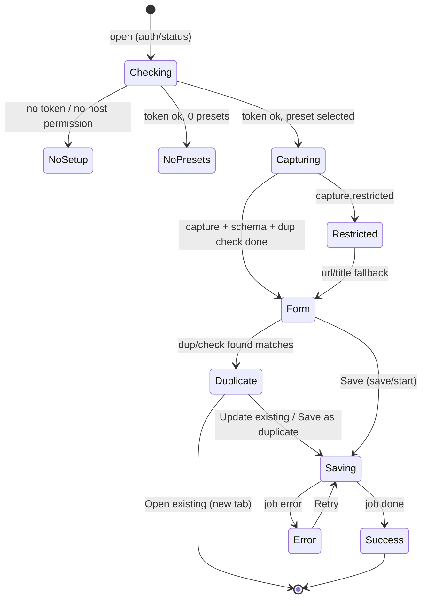

# UI flows

Two UI surfaces: the **popup** (toolbar button) and the **options page** (setup wizard, presets, settings). Both are Preact apps that talk to the background only through `sendRequest()` ([architecture.md](./architecture.md#message-protocol)). Styling uses the tokens in `src/ui/theme.css` (light/dark).

## Popup

### No setup

Shown when `auth/status` reports `hasToken: false` or `hostPermission: false`. Message ("Connect Sitecatch to Notion to start saving") plus an **Open setup** button that opens the options wizard. If only the host permission is missing, a **Grant access** button calls `browser.permissions.request` from the click handler. There are no other controls.

If there are no presets yet: "Create your first preset" → opens Options → Presets.

### Capturing

- **Preset picker** at the top, preselected with `local:lastPresetId` (falls back to the first preset). Changing the preset stores it as the new `lastPresetId`, re-runs schema validation and the duplicate check, and re-resolves the form. The capture is reused, and the user's edits are kept for properties the new preset also shows with the same input kind (e.g. the title).
- Three requests run in parallel: `capture/run`, `ds/schema`, `dup/check` (with the tab URL; the capture URL if the tab URL is unknown; skipped when the preset has no dedupe property). Skeletons are shown for the thumbnail and fields, and a polite live region announces "Capturing page…".
- Capture waits for `readyState === 'complete'` plus the optional delay from Settings.
- If `capture/run` fails, the error is shown with **Retry** and the form falls back to the tab's URL and title (like a restricted page).

### Form

- Thumbnail of the screenshot, if the preset uses one, plus the page title/domain.
- One field per **visible mapping**: every `ask` mapping, plus `extractor`/`static` mappings with `editableInPopup`. The input matches the property type (Text, Url, Number, Checkbox, Date, Select, MultiSelect with "create option", Status).
- Pre-filled from extractors (primary → fallbacks), `ask.default`, or the static value.
- Mappings that aren't shown as fields (non-editable extractor/static) are listed in a compact read-only summary, e.g. "URL → https://example.com/…".
- `required` ask fields block **Save** until filled; the footer says which fields are missing.
- **Save** stays disabled while capturing, loading the schema, or checking for duplicates. Its label is "Save to *Database*" (or "Save as duplicate" when duplicates were found). **Ctrl/⌘ + Enter** saves from anywhere; the first editable field gets focus.
- Capture warnings (e.g. "Screenshot was downscaled") appear as small notes.
- **Preset issues** ([preset-model.md](./preset-model.md#validation)): blocking issues disable Save and show **Edit preset**. Non-blocking ones (renamed, select option will be created, dedupe skipped) show as a dismissible notice.

### Duplicate banner

Shown above the form when `dup/check` returns matches: "Already saved in *Resources*: '<title>', edited <relative time>."

| Button | Effect |
| --- | --- |
| **Update existing** | `save/start` with `mode: {kind:'update', pageId}`. Replaces mapped properties, cover and icon. No new body image. |
| **Save as duplicate** | `save/start` with `mode: {kind:'duplicate'}`. Creates a new page. |
| **Open existing** | Opens the existing page's Notion URL in a new tab. Saves nothing. |

With several matches, the banner shows the most recently edited one and a count. The footer **Save** button becomes **Save as duplicate**.

### Saving

`save/start` returns a `jobId`. The popup watches the job in `storage.session` (`watchJob`) and polls `job/get` every second as a fallback, showing the step: *Uploading screenshot…* (`uploading`), then *Saving to Notion…* (`creating`). After 20 s it adds "Still working… it continues in the background — you can close this popup." The user may close the popup at any time; that only stops watching. The save continues in the background and the toolbar badge shows ✓ (done) or ! (error).

The popup remembers its most recent job in `session:popup:lastJob` (`{ jobId, presetId, url, mode }`). Reopened on the same page, it shows that job's progress if it is still running, or its error if it failed.

### Success

"Saved to *Resources*" with an **Open in Notion** button (`JobState.pageUrl`, opens in a new tab), **Save with another preset** (back to the form, duplicate check re-run) and **Close**. The popup doesn't close by itself. The entry is added to `local:history`. Reopening it on the same page shows the duplicate banner.

### Error

The `AppError.message` in plain language, with a button for `action`:

| `action` | Button |
| --- | --- |
| `open-setup` | Open setup (options `#/setup`) |
| `reshare-db` | How to share (options `#/help`) |
| `retry` | Retry (for a failed create, the duplicate check runs again first; if it now finds the page, the duplicate banner is shown instead of saving) |
| `edit-preset` | Edit preset (options `#/presets/<id>`) |
| `grant-permission` | Grant access (`permissions.request` for `https://api.notion.com/*`, called synchronously in the click handler; retries on success) |

Buttons that open the options page open it in a new tab at that route and close the popup.

A collapsible **Details** section shows `AppError.detail` (HTTP status, Notion code). It never shows the token.

### Restricted page

For about:/chrome:// pages, add-on and web stores, the PDF viewer, reader mode, view-source, etc., the probe and screenshot can't run. The popup shows a notice with `restrictedReason` (e.g. "Firefox doesn't allow extensions on add-on store pages") and still offers the form with **URL, tab title and date saved** only. Mappings that depend on other extractors stay empty, and `ask` fields still work.

## Options page

Sections: **Setup**, **Presets**, **Settings**, **Import/Export**, **Help**. Opens automatically on install (`runtime.onInstalled`, reason `install`).

### Setup wizard

Five steps matching [setup-guide.md](./setup-guide.md). Each step has exact instructions and a screenshot slot (`ScreenshotSlot`, filled with real screenshots later):

1. **Create the connection**: link to the Notion Developer portal, the field values to use, and the capabilities to check.
2. **Copy the token**: where to find it on the Configuration tab.
3. **Connect**: **Grant access** (api.notion.com, `permissions.request` in the click handler) when missing. Token field, validated instantly with `auth/validate`, showing bot name + workspace or an actionable error.
4. **Share databases**: ••• → Connections → Add connection → Sitecatch → Confirm.
5. **Your databases**: `ds/list` result with search and **Refresh**. Empty state "Can't see your database?" lists the causes from the setup guide. Ends with **Create your first preset**.

Completed steps collapse. The wizard can be revisited, e.g. to replace the token.

### Presets list

Ordered list (`sync:presetIndex`) showing name, target database and an issue badge. Actions: **New**, **Edit**, **Duplicate**, **Delete** (with confirm), drag to reorder.

### Preset editor

1. Name + **database picker** (`ds/list`).
2. **Property table** (from `ds/schema`): every writable property, with a **source** selector (Not mapped / Extractor + fallbacks / Ask in popup / Static value) and an **Editable in popup** toggle. Extractor choices are filtered by the [compatibility matrix](./preset-model.md#compatibility-matrix). Read-only property types appear disabled with a reason.
3. **Screenshot**: files property (or none), "also add to page body".
4. **Cover**: none / screenshot / Open Graph image. **Icon**: none / favicon.
5. **Duplicate detection**: url/text property, or off.
6. Validation issues shown inline. Save is disabled while blocking issues remain.

### Settings

- Capture delay (ms) after page load.
- Screenshot JPEG quality.
- Connected workspace + **Disconnect** (`auth/clear`).
- Recent saves (`local:history`, last 20) with links.

### Import / Export

- **Export** downloads `sitecatch-presets-<date>.json` (`PresetExportFile`, presets only, never the token).
- **Import** opens a file picker, validates the file, and previews the presets with any id conflicts (replace / keep both) before writing. See [preset-model.md](./preset-model.md#import--export).
